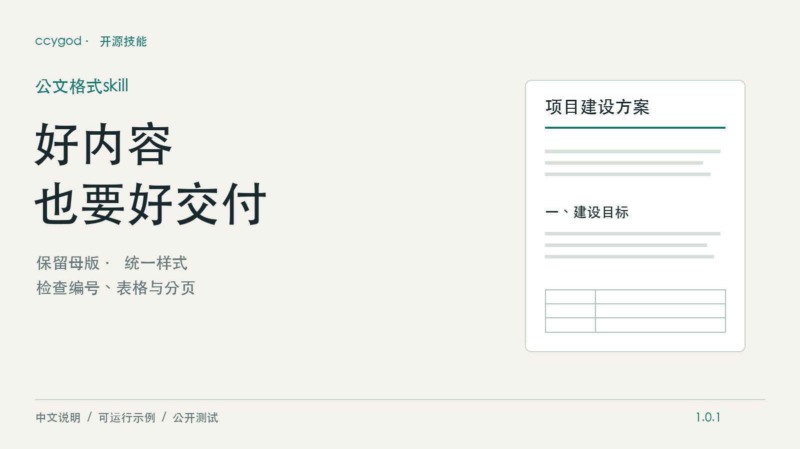
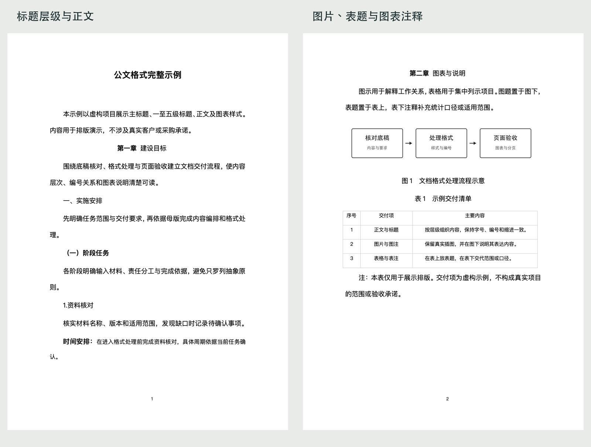

# 公文格式skill

**把精心设计的公文样式，变成可复用、可检查的文档交付流程。**



[快速开始](#快速开始) · [发布版本](https://github.com/ccygod/artifact-template-wps/releases) · [验证记录](docs/validation.md)

## 为什么把公文排版做成Skill

一份文档可能看着差不多，却留下编号比标题小、正文缩进串到标题、表格跨页损坏、页码或母版结构丢失等问题。这个Skill把保留母版、明确角色、确定性格式处理与成品检查组织成一个工作流。

它基于作者亲自设计并持续校正的样式体系，适用于项目方案、机构汇报和正式文档。**这里的“公文格式”是项目名称及样式定位，不代表对所有法定公文标准的认证。**

## 看实际效果



这份原创虚构示例使用公开母版，在macOS WPS中实际渲染。目标设备的字体和软件版本可能改变页貌。

| 常见问题 | 工作流怎样处理 |
| --- | --- |
| 标题字变大，编号仍然很小 | 核对编号级别实际字体与字号 |
| 正文首行缩进套到标题 | 区分正文与标题角色 |
| 表格看着像表格，结构却不对 | 核对表题、单元格样式、宽度和分页 |
| 修改后页码或WPS结构丢失 | 对照包部件与显式变更允许清单 |
| 每处理一次又多出变化 | 比较第二次处理后的语义快照 |

## 快速开始

```bash
git clone https://github.com/ccygod/artifact-template-wps.git
cd artifact-template-wps
python3 -m pip install -r requirements.txt
python3 scripts/install_skill.py --host codex
```

Claude Code用 `--host claude`；其他宿主用 `--dest /你的技能目录/artifact-template-wps`。安装器拒绝覆盖已有目录，保留你的修改。[兼容性说明](docs/compatibility.md)。

安装后可以这样说：

```text
用 $artifact-template-wps 处理这份方案定稿。
正文四号（14磅），主标题大小保持独立。
采用公开母版，保留其样式层级。
完成格式检查并用WPS渲染，无法执行的验收项如实说明。
```

**修改格式前必须给出具体正文字号。**“按模板”不等于确认字号。正文内容、事实和本次要求由你提供。

## 三分钟体验

无需调用模型或付费API，直接用虚构示例体验确定性格式处理：

```bash
python3 examples/build_demo.py /tmp/official-demo-input.docx
python3 scripts/apply_official_rules.py \
  /tmp/official-demo-input.docx /tmp/official-demo.docx \
  --body-half-points 28
python3 scripts/check_official_document.py /tmp/official-demo.docx \
  --expected-half-points 28 --expected-line-multiple 1.35 \
  --expected-before-lines 0 --expected-after-lines 25 \
  --expected-table-after-lines 50 --require-snap-to-grid-off
```

检查器预期输出 `PASS`。再用目标Word/WPS打开检查页面；Windows请把 `/tmp/...` 替换成可写本地路径。[完整验收步骤](docs/verification.md)。

## 怎样工作

`识别母版 → 解析有效样式与角色 → 在副本中编辑 → 格式处理 → 结构检查 → 实际渲染`

保留母版中的样式、编号、分节、目录字段、页脚和WPS扩展。模型负责内容和结构判断，脚本负责可重复的格式修改；变更白名单和幂等检查帮助发现意外损坏。

格式脚本是内容编排之后的处理器，不能替你编写材料、推断全部缺失结构或自动修好所有目录问题。示例构建器仅用于生成示例本身。

## 包含的检查

- 正文与标题字号、编号字号一致性、行距与段间距；
- 文档网格对齐和要求启用的分页控制；
- 手工编号与自动编号冲突；
- 表题、图注、表格单元格的语义样式；
- 未修改包部件保留与重复处理的语义稳定性。

```bash
python3 -m unittest discover -s scripts -p 'test_*.py' -v
```

## 公开母版与字体

公开版将原样例机构、地区、项目名称换成通用示例，清理文档身份元数据，并移除嵌入字体文件；保留母版结构与样式。字体名称不等于字体文件授权，请使用你合法安装的字体或明确替换为当地可用字体，再重新渲染。

正文与标题1—5按本次明确字号处理，主标题单独保留；默认1.35倍行距属于此样式体系。它不是所有公文的通用法定要求。

[母版结构说明](STYLE_MANIFEST.md) · [WPS结构保真](WPS_OOXML_PRESERVATION.md) · [权利说明](NOTICE.md)

## 适用条件与证据

脚本需要Python 3.10+和lxml；文档编辑与渲染能力由宿主或外部软件提供。本版真实页面检查使用macOS WPS，不能由此承诺其他Word/WPS版本分页完全相同。

[实际验证记录](docs/validation.md) · [贡献指南](CONTRIBUTING.md) · [帮助](SUPPORT.md)

作者：[ccygod](https://github.com/ccygod)。可与 [Lecture](https://github.com/ccygod/lecture) 配合，用于口播和页面说明的正式文档交付。

[发布文案](docs/launch-kit.md) · [开源许可证](LICENSE)
