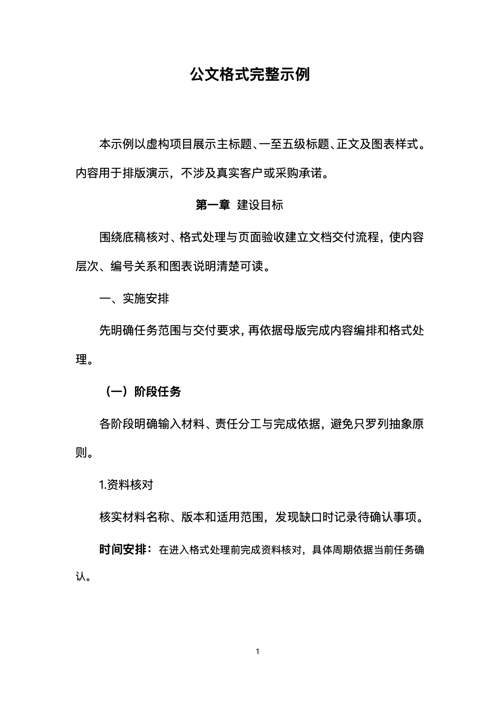
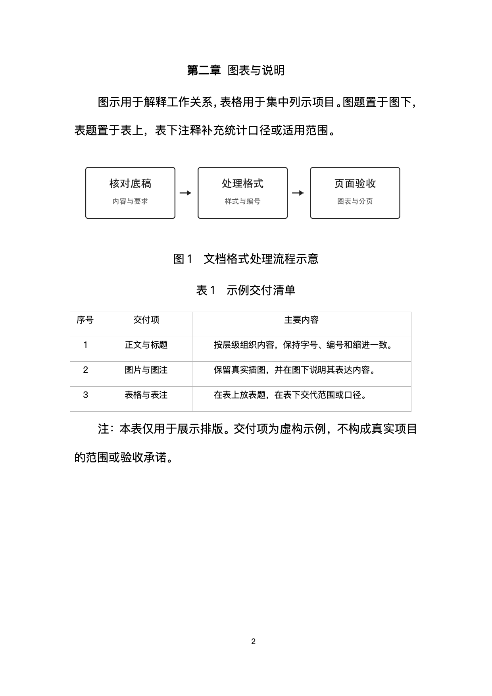

# 多格式文档格式Skill

**标题、正文、图片、图表说明，都在同一套公文样式里。**


[看完整示例](#先看完整示例) · [快速开始](#快速开始) · [下载版本](https://github.com/ccygod/official-document-format/releases) · [实际验证](docs/validation.md)

写完内容之后，常常还剩一轮细碎排版：标题与编号对不齐，标题和正文缩进不符合本次要求，图片和图注分开，表格换页后失去表头。**multi-document-format把你选定的母版、段落角色、格式处理和成品检查组织成一个可复用流程。**

适用于中文公文、校领导/客户汇报、行业报告、中文学位论文和技术手册。正式Word/WPS模板优先；没有模板时选择对应格式包。

## v1.2.4：多格式文档与强制风格选择入口

本轮把反复出现的问题收敛为统一入口和真实属性检查，新增[验证记录与能力边界](docs/validation.md)。默认从标题2开始，内容标题与正文均首行缩进2字符；主标题居中。下方旧的五级展示明确演示“保留标题1”的可选模式，不代表默认必须使用标题1。

```sh
python scripts/pipeline.py formats
python scripts/pipeline.py inspect input.docx --out inventory.json
# 先选择格式，再确认正文字号，然后形成完整roles.json
python scripts/pipeline.py format input.docx output.docx \
  --format-profile official_cn --role-map roles.json \
  --body-half-points 24 --numbering-mode automatic --report audit.json
```

格式包选择：

| id | 用途 |
|---|---|
| `official_cn` | 中文公文，默认从标题2开始 |
| `briefing_cn` | 中文汇报材料 |
| `industry_report_cn` | 中文行业报告 |
| `academic_thesis_cn` | 中文学位论文通用起点 |
| `technical_manual_cn` | 中文技术手册 |

格式包定义相对字号比例。用户选正文12磅或14磅后，标题、编号、题注和其他角色按格式包自动计算。用户提供学校、单位、期刊或客户正式模板时，模板优先于通用格式包。详见[多格式路线与外部借鉴](docs/format-ecosystem.md)。

每次处理前强制确认三项：文档格式、正文字号、标题是否使用自动序号。`automatic`使用带自动编号定义的预设标题样式，便于后续修改层级后自动更新；`manual`移除标题样式和段落的自动编号，只保留原文已有的人工编号。不会根据标题外观猜测用户选择。

可下载[陌生合成原稿](examples/forward-case/input.docx)、[对应角色与表题清单](examples/forward-case/roles.json)、[处理结果](examples/forward-case/output.docx)。该案例经过独立评估，现已纳入回归，不作为未来的未见测试集。

56项自动化测试通过不等于所有新文档自动正确。入口先强制询问文档风格、正文字号和标题编号模式，再进入检查和处理；后续仍记录结构检查、内容保留、重复处理和OOXML属性顺序，视觉状态保持待验收。WPS逐页检查后才能交付。表格本体的页面居中由`tblPr/jc=center`和实际渲染共同验收。复杂对象按边界分流。

[v1.2.2全格式与多材料测试矩阵](docs/test-matrix-v1.2.2.md)

[v1.2.3底层OOXML与WPS回归矩阵](docs/test-matrix-v1.2.3.md)

## 先看完整示例

下面是同一份Word示例的两页实际效果，由WPS渲染。机构、内容及交付事项均为虚构；图片为本项目原创流程示意。


**[下载可编辑Word示例](examples/official-demo.docx)** · [查看标题页高清图](assets/demo-headings.png) · [查看图表页高清图](assets/demo-figures-tables.png)

| 示例里展示什么 | 你能看到的细节 |
| --- | --- |
| 主标题 | “公文格式完整示例”，与正文层级分开 |
| 一级标题 | “第一章 建设目标”，展示章标题与编号 |
| 二级标题 | “一、实施安排”，展示下一层组织关系 |
| 三级标题 | “（一）阶段任务”，继续细分内容 |
| 四级标题 | “1.资料核对”，呈现具体事项 |
| 五级标题 | “时间安排：”标签后接正文，标签与正文采用不同文本格式 |
| 正文 | 首行缩进、行距与段间距，和标题样式区分 |
| 实际图片 | 插入“核对底稿→处理格式→页面验收”流程图 |
| 图注 | 独立放在图片下方，使用“图1”编号 |
| 表题与表格 | “表1 示例交付清单”放在表格上方，短字段与长句采用不同单元格角色 |
| 表下注释 | 用“注：”说明表格范围，位于表格下方 |
| 页码 | 保留页脚与连续页码 |

<details>
<summary>展开高清页面：各级标题与正文</summary>



</details>

<details>
<summary>展开高清页面：图片、图注、表题和表注</summary>



</details>

图注与表题采用同一套图片样式和常规字重；表下注释负责补充范围，不与表题混用。此示例采用正文四号、1.35倍行距。字体和软件版本可能改变具体页貌，以目标环境打开结果为准。

## 它能帮你处理什么

| 常见问题 | 处理与检查方式 |
| --- | --- |
| 标题字改大了，编号仍然很小 | 同步编号级别的有效字体和字号 |
| 标题和正文缩进不一致 | 同时核对样式定义与段落实例 |
| 五级标签后面一整行都变成标题 | 分开标签与同行正文的文本格式 |
| 表格视觉像样，实际段落样式混乱 | 核对单元格语义、表题、列宽与重复表头 |
| 图片和图注、表题和表格散开 | 核对相邻关系、同页设置与实际分页 |
| 修改后页码或WPS结构丢失 | 以明确允许清单对照包部件 |
| 每处理一次，又多出编号或空段 | 比较再次处理后的语义快照 |

## 快速开始

```bash
git clone https://github.com/ccygod/official-document-format.git
cd official-document-format
python3 -m pip install -r requirements.txt
python3 scripts/install_skill.py --host codex
```

Claude Code使用`--host claude`；其他宿主通过`--dest`指定目录。安装器遇到已有目录会停止，不覆盖个人修改。[安装与兼容性](docs/compatibility.md) · [旧名称迁移](docs/migration.md)。

安装后可以这样说：

```text
用 $multi-document-format 处理这份方案定稿。
正文四号（14磅），主标题大小保持独立。
采用公开母版，保留标题层级、图片、图注、表题和表下注释。
完成格式检查并用WPS渲染，无法执行的验收项如实说明。
```

修改格式前须给出具体正文字号。内容、事实和本次偏离要求由用户提供；未明确改动的版式遵循母版。

## 三分钟体验

示例可以本地重建，不需要模型或付费API：

```bash
python3 examples/build_demo.py /tmp/official-demo-input.docx
python3 scripts/apply_official_rules.py /tmp/official-demo-input.docx /tmp/official-demo.docx --body-half-points 28
python3 scripts/check_official_document.py /tmp/official-demo.docx --expected-half-points 28 --expected-line-multiple 1.35 --expected-before-lines 0 --expected-after-lines 25 --expected-table-after-lines 50 --require-snap-to-grid-off
```

预期输出`PASS`。再用目标Word/WPS打开检查页面。Windows请将/tmp路径换成可写本地路径。[完整验收步骤](docs/verification.md)。

## 怎样工作

`识别母版 → 解析有效样式与角色 → 在副本中编辑 → 格式处理 → 结构检查 → 实际渲染`

模型负责内容和结构判断，脚本负责可重复的格式修改。保留样式、编号、分节、目录域、页脚和WPS扩展，并用变更允许清单与重复处理检查发现意外损坏。

格式脚本是内容编排后的处理器，不会代写材料或自动修复全部缺失结构。示例构建器只重建本示例，不能当作通用方案生成器。

## 验证与适用条件

```bash
python3 -m unittest discover -s scripts -p 'test_*.py' -v
```

公开包使用通用样例，清理身份元数据，不分发嵌入字体。请使用合法安装的字体或明确选择替代字体，再渲染检查。

本项目是一套具体公文排版体系，不代表对所有法定公文标准的认证。脚本需要Python 3.10及以上版本与lxml；编辑与渲染工具由宿主提供。页面证据来自macOS WPS，不承诺其他软件和字体环境分页完全相同。

[实际验证记录](docs/validation.md) · [母版结构](STYLE_MANIFEST.md) · [WPS结构保真](WPS_OOXML_PRESERVATION.md) · [来源与权利说明](NOTICE.md)

## 参与与交流

作者：[ccygod](https://github.com/ccygod)。配合[Lecture](https://github.com/ccygod/lecture)可处理中文口播与逐页制作说明。

[贡献指南](CONTRIBUTING.md) · [使用帮助](SUPPORT.md) · [发布文案](docs/launch-kit.md) · [开源许可证](LICENSE)
